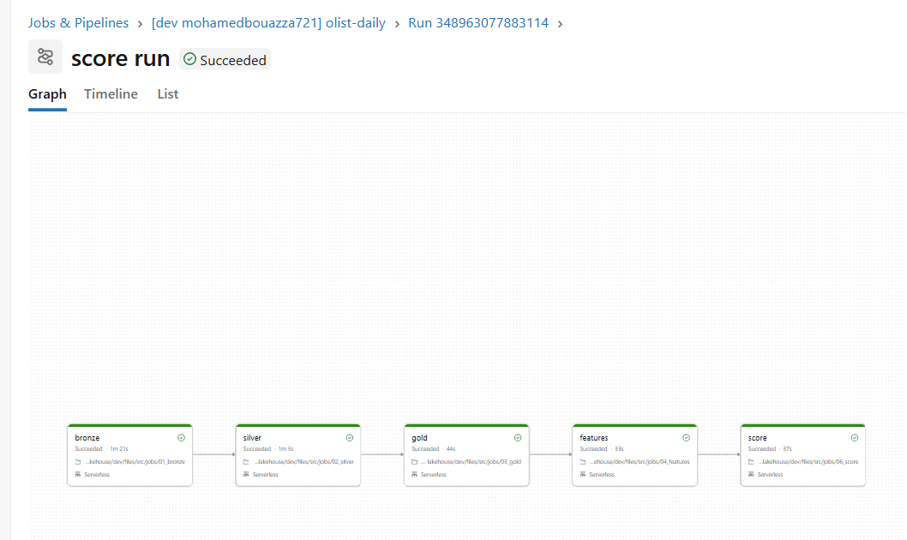
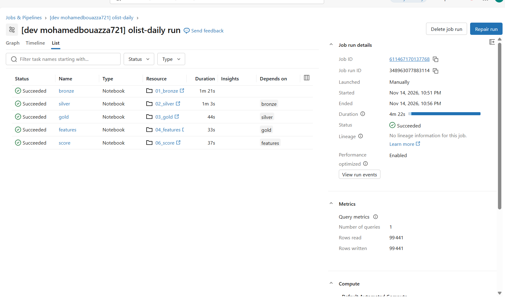

# olist-lakehouse

Prédire, au moment où une commande e-commerce est approuvée, si elle sera livrée
en retard. Projet de bout en bout sur Databricks : ingestion, lakehouse en
médaillon, features, entraînement, scoring et orchestration.

Données : [Brazilian E-Commerce Public Dataset by Olist](https://www.kaggle.com/datasets/olistbr/brazilian-ecommerce)
(99 441 commandes, 2016-2018).

## Architecture

```
9 fichiers CSV
   │ 01_bronze    copie fidèle, tout en texte
   ▼
Bronze (9 tables)
   │ 02_silver    types, nettoyage, indicateurs de qualité, cible en_retard
   ▼
Silver (8 tables)
   │ 03_gold      schéma en étoile : 5 dimensions, 2 tables de faits
   ▼
Gold
   │ 04_features  une ligne par commande, 34 colonnes connues à l'approbation
   ▼
ml.features_commandes
   │ 05_train     4 modèles comparés, suivi MLflow        (à la demande)
   ▼
Unity Catalog : delivery_delay_model, alias « champion »
   │ 06_score     probabilité et alerte par commande
   ▼
gold_delivery_predictions
```

Le job quotidien `olist-daily` enchaîne bronze → silver → gold → features → score.
Il est décrit en YAML (Databricks Asset Bundle) et déployé en une commande.





## Résultats

Quatre modèles entraînés sur janvier 2017 - mars 2018, comparés sur avril-mai 2018
(validation), le meilleur mesuré une seule fois sur juin-août 2018 (test).

| Modèle (validation) | PR-AUC | Lift |
|---|---|---|
| **Régression logistique** | **0,175** | **×3,2** |
| LightGBM | 0,148 | ×2,7 |
| XGBoost | 0,140 | ×2,5 |
| Random forest | 0,133 | ×2,4 |

| Champion | Validation | Test |
|---|---|---|
| PR-AUC | 0,175 | 0,078 |
| Part de retards (hasard) | 0,055 | 0,036 |
| Lift | ×3,2 | ×2,1 |
| Commandes en alerte (seuil 0,208) | 11 % | 34 % |

Le modèle classe les retards deux à trois fois mieux que le hasard, mais il se
dégrade sur le test : le taux d'alertes triple alors que les retards réels
baissent. La cause probable est un changement de distribution après la grève des
transporteurs de mai 2018. C'est le cas que le monitoring doit détecter.

## Choix techniques

- **Pas de fuite de données.** Les features d'historique (taux de retard du
  vendeur, de la route, de la plateforme) ne comptent que les événements
  strictement antérieurs à l'approbation. Un contrôle recalcule l'historique
  d'une commande par un autre chemin et compare.
- **Découpage temporel.** Modèle et seuil choisis sur la validation, test
  regardé une seule fois.
- **Même préparation à l'entraînement et au scoring.** Une seule fonction,
  `colonnes_typees()`, sert aux deux. Le scoring recalcule la PR-AUC du test et
  vérifie qu'elle est identique à celle de l'entraînement (0,0780).
- **Modèle chargé par alias.** Le scoring lit `@champion` et son seuil dans
  Unity Catalog : changer de modèle ne demande aucune modification de code.
- **Tables idempotentes.** Chaque étape réécrit sa table Delta en entier ;
  relancer le job donne le même résultat.

## Organisation du dépôt

| Chemin | Contenu |
|---|---|
| `src/olist/` | la logique : `bronze.py`, `silver.py`, `gold.py`, `geo.py`, `features.py`, `train.py`, `scoring.py` |
| `src/jobs/` | les notebooks `01_bronze` à `06_score`, qui appellent ces modules |
| `resources/olist_daily.job.yml` | la définition du job |
| `databricks.yml` | la configuration du bundle |
| `_cicd/bootstrap.sql` | création des catalogues, schémas et volumes |
| `_adhoc/eda/` | l'analyse exploratoire |
| `docs/` | explications détaillées de l'entraînement et du MLOps |

## Reproduire

1. Exécuter `_cicd/bootstrap.sql` dans Databricks.
2. Déposer les 9 CSV Olist dans le volume `olist_dev.raw.source_olist`.
3. Déployer le bundle :
   ```
   databricks bundle deploy -t dev
   ```
4. Exécuter les notebooks `01_bronze` à `05_train` une première fois : `05_train`
   publie le modèle champion, dont la tâche `score` a besoin.
5. Lancer le job :
   ```
   databricks bundle run olist_daily -t dev
   ```

## Limites et suite

- Le modèle n'apprend que sur les commandes livrées : il ne prédit pas les
  annulations.
- La performance est modeste (lift ×2,1 en test) et un seuil fixe en probabilité
  est fragile quand les probabilités dérivent.
- À faire : monitoring (taux d'alertes, PSI, lift par semaine de scoring),
  réentraînement mensuel avec comparaison champion / challenger, tests
  unitaires, déploiement par GitHub Actions.
